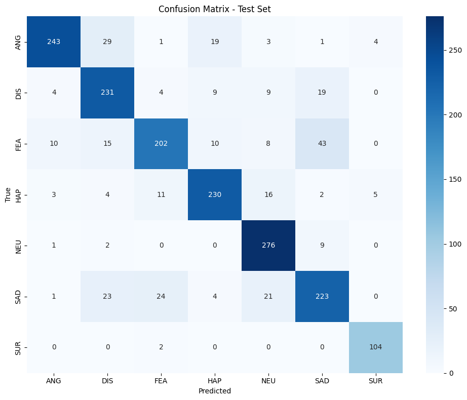

# Speech and Text Emotion Recognition

Emotion recognition experiments for **speech waveforms** and **written text**, with a Telegram interface prototype that accepts text and voice messages. The acoustic and text models are separate experiments.

## Components

| Component | Approach | Output |
| --- | --- | --- |
| Speech emotion recognition | Fine-tuned `facebook/wav2vec2-base` with mean pooling and a classification head | Anger, disgust, fear, happiness, neutral, sadness, surprise |
| Text emotion classification | Text normalization, frozen 50-dimensional GloVe embeddings, and a PyTorch Transformer prototype | Anger, happiness, love, neutral, surprise, worry |
| Telegram interface | Text classification; voice → speech-to-text → text classification | Predicted text emotion and voice transcription |

The Telegram voice path uses Google speech recognition followed by the **text model**. The Wav2Vec2 acoustic classifier is not connected to the bot, and the repository does not implement joint multimodal fusion.

## Saved results

The speech notebook reports **83% accuracy** and **0.84 macro F1** on 1,825 held-out clips, after assembling 12,162 clips from CREMA-D, RAVDESS, SAVEE, and TESS. These are saved results from a random clip-level split, not a speaker-independent benchmark or a new training run.

The text notebook contains a partial, interrupted training run. It also has a batch/sequence layout issue in the Transformer implementation. **No final text accuracy is claimed.** See [results and limitations](reports/results.md) before interpreting either model.



## Repository contents

| Path | Purpose |
| --- | --- |
| [01_speech_emotion.ipynb](notebooks/01_speech_emotion.ipynb) | Corpus parsing, Wav2Vec2 fine-tuning, and speech evaluation |
| [02_text_emotion_and_bot.ipynb](notebooks/02_text_emotion_and_bot.ipynb) | Text preparation, GloVe/Transformer prototype, and opt-in Telegram code |
| [originals/](originals/) | Historical outputs; the text notebook is credential-sanitized |
| [reports/project_report.pdf](reports/project_report.pdf) | Original Persian report body |
| [data/README.md](data/README.md) | Dataset and embedding setup |
| [docs/REPRODUCIBILITY.md](docs/REPRODUCIBILITY.md) | Environment, packaging changes, and issues to resolve |

## Getting started

Use Python 3.11 and a fresh virtual environment. Speech training benefits from a CUDA-capable GPU.

```bash
git clone https://github.com/Arian-Abdollahi/speech-text-emotion-recognition.git
cd speech-text-emotion-recognition
python -m venv .venv
source .venv/bin/activate
# Choose the experiment you want to inspect:
python -m pip install -r requirements-speech.txt
# For the text notebook, use a separate environment:
# python -m pip install -r requirements-text.txt
jupyter lab
```

On Windows, activate with `.venv\Scripts\activate`.

Download the datasets and GloVe file separately using [data/README.md](data/README.md). Open the corresponding notebook and run the setup cell first. Training datasets, tokenizer files, and model weights are not included. Dependency ranges are compatibility suggestions, not a fully reproduced environment lock.

## Telegram prototype

The supplied bot uses the legacy `python-telegram-bot==13.15` API. Its dependencies are listed separately in [requirements-bot-legacy.txt](requirements-bot-legacy.txt); they are not needed for text training. Modern Jupyter environments can conflict with that old bot stack, so port or isolate the bot before running it. Bot startup is disabled by default. After correcting the text model and training compatible weights, set `TELEGRAM_BOT_TOKEN` locally and opt in with `RUN_TELEGRAM_BOT=1`. See [.env.example](.env.example); that file is a template and is not loaded automatically.

Voice transcription contacts an external speech-recognition service. The supplied bot uses shared temporary filenames and is a local prototype, so it needs concurrency and error-handling improvements before deployment.

See [credits](CREDITS.md) and [verification](docs/VERIFICATION.md).
